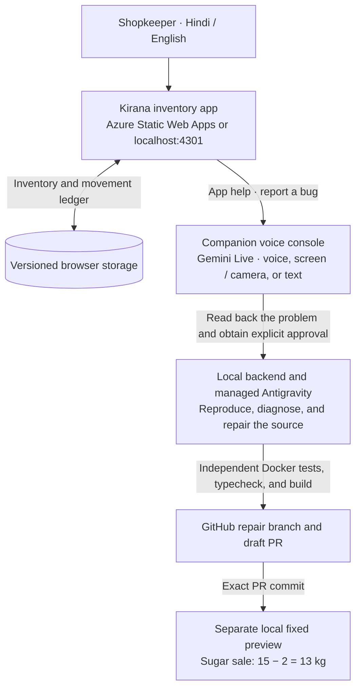

# किराना साथी

Standalone Hindi/English inventory demo for a small grocery shop, available locally and on Azure Static Web Apps. All eight products, stock quantities, prices, and transactions are synthetic public demo data. The merchant screen uses cream/forest-green/saffron colors, selectable cards or a table, a stock receipt/sale form, a low-stock view, and a movement ledger. Use the top-right Hindi/English switch to match the audience.

## App demo video

**[▶ Watch / download the Kirana Saathi app demo (MP4)](https://github.com/monuminu/gemini-kirana-bugfix-agent/releases/download/demo-video-2026-11-01/kirana-saathi-app-demo.mp4)**

The approximately **7-minute** recording is uploaded unchanged as a [GitHub release asset](https://github.com/monuminu/gemini-kirana-bugfix-agent/releases/tag/demo-video-2026-11-01) in the companion project. Open the MP4 in your browser or download it to play locally.

## How the two apps work together



1. Use this app to search products, receive stock, record sales, and inspect low stock or the ledger. Inventory is stored in the browser.
2. Reproduce the seeded defect: selling 2 kg of sugar changes **15 kg to 17 kg**. Open **App help / ऐप सहायता** to describe the problem in the companion console.
3. Confirm Gemini's complete read-back. Antigravity diagnoses and repairs the source after explicit approval; the backend independently verifies the patch before creating a draft PR.
4. Open the separate preview to see the corrected **13 kg** result. The public Azure app keeps the intentional bug for repeatable demonstrations; a draft PR does not redeploy it.

The inventory frontend needs no credentials and has no voice inventory operations. The companion project owns Gemini access, consent, repair jobs, GitHub publication, and Docker previews. See the [full architecture and workflow](https://github.com/monuminu/gemini-kirana-bugfix-agent#architecture-and-workflow) and [voice agent setup](https://github.com/monuminu/gemini-kirana-bugfix-agent#run-locally).

## Run locally

Use Node.js 22.12+ and npm. No account, API key, cloud service, or credentials are required.

```sh
npm ci
npm run dev
```

Open [किराना साथी](http://127.0.0.1:4301). The development server binds to loopback and fails if port 4301 is occupied.

“ऐप सहायता” opens the companion support experience at `http://127.0.0.1:4300` in another tab. To override that destination at build time, copy `.env.example` to `.env.local` and set `VITE_SUPPORT_URL`. This is a public URL, not a secret; Vite exposes `VITE_` values to the browser.

## दो मिनट का डेमो

1. “नमूना फिर से शुरू करें” दबाएँ और “फिर से शुरू करें” की पुष्टि करें।
2. चीनी चुनें। उपलब्ध स्टॉक **15 किलो** है।
3. “बिक्री हुई” चुनें, “मात्रा” में **2** लिखें, फिर “बिक्री दर्ज करें” दबाएँ।
4. स्टॉक **17 किलो** दिखाई देगा। दुकानदार सहायता में कह सकता है: **“चीनी 15 किलो थी। 2 किलो बेचने पर 13 होना चाहिए, लेकिन 17 दिख रहा है।”**
5. “ऐप सहायता” खोलें और साथी support/repair demo में यह समस्या बताएँ।
6. “लेन-देन” में उसी बिक्री की मात्रा और पहले/बाद का स्टॉक देखें।
7. सामान्य उपयोग देखने के लिए रीसेट करें, “माल आया” चुनें और **1.25 किलो** चीनी जोड़ें; सही नया स्टॉक **16.25 किलो** होगा। “कम स्टॉक” में दूध और साबुन दिखेंगे।

The inventory app has no microphone or inventory voice controls. Voice support belongs to the companion app.

## The deliberately real source defect

This repository intentionally ships **one source defect** in the sale branch of `src/inventory.ts`: `recordMovement` adds the sale quantity to stock. There are no fault flags, fake errors, hidden alternate code paths, or runtime switching. Receipts add stock correctly; sales should subtract it. The conventional regression in `src/inventory.regression.test.ts` expects **13,000 grams** after selling **2 kg** from **15 kg**, so it fails with **17,000** until that source branch is repaired.

```sh
npm test               # Exits 1: exactly the conventional sale regression fails.
npm run test:baseline  # Other invariants pass; then separately proves the exact expected regression.
npm run typecheck
npm run build
```

`test:baseline` excludes the regression only from its first run. Its second, explicitly reported probe runs the conventional regression alone and requires the exact failing 17,000/13,000 result. It fails if the probe unexpectedly passes or fails for another reason. It does not change, skip, mark as expected-to-fail, or mask the normal `npm test` result. After a repair, use **`npm test`** as the success oracle; the original-defect baseline intentionally no longer succeeds.

## Inventory contracts

- `initialInventory()` returns a fresh deterministic state with eight products and no movements.
- `recordMovement(state, productId, 'in' | 'sale', quantity)` accepts display units (kg, litres, whole packets/pieces), returns a new state, and records integer base quantities plus the before/after stock in a newest-first ledger.
- Internal stock uses integer grams, millilitres, or pieces. Unit prices use integer paise. Decimal scaling validates grams/ml exactly; packets and pieces cannot be fractional. Zero, negative, non-finite, unsafe or oversell quantities are rejected.
- `formatQuantity` and `formatMoney` turn base units into readable shop quantities and rupees.
- Versioned localStorage key: `kirana-saathi.inventory.v1`. Valid state survives reload. Malformed JSON, unsupported versions, wrong product units, unsafe integers, and broken ledger structure reset safely to seed data. Unavailable browser storage leaves the current page usable.
- The browser’s reset confirmation returns all stock and ledger entries to the deterministic seed. No data is transmitted by this app.

## Static build and isolated runners

`npm run build` writes `dist/`. Vite uses `base: './'`, so the generated JS/CSS asset references work in a static container, including when served beneath a preview path. The trusted repair runner may run `npm ci --ignore-scripts`, `npm test`, `npm run typecheck`, and `npm run build` against a checkout. Installation and build need no secrets.

For example, build locally and serve only the compiled static assets:

```sh
npm ci --ignore-scripts
npm run build
docker run --rm -p 127.0.0.1:4301:80 \
  --mount type=bind,source="$PWD/dist",target=/usr/share/nginx/html,readonly \
  nginx:alpine
```

This command serves the merchant app. The companion support app is a separate process and URL. A container’s build/test environment can use Node 22 or later; the Vitest worker disables Node’s experimental native Web Storage so tests exercise real jsdom browser storage consistently on newer Node versions.

## Azure deployment

Open the public Hindi inventory demo at [किराना साथी on Azure](https://thankful-bay-05dfcb500.1.azurestaticapps.net). It is hosted on **Azure Static Web Apps, Free tier**, in the isolated `rg-kirana-saathi-demo` resource group. The deployed baseline preserves the intentional sale defect: selling 2 kg of sugar from 15 kg shows 17 kg. Reset restores the synthetic seed data.

The app runs entirely in the browser and stores each visitor's demo inventory in that browser's localStorage. “ऐप सहायता” opens the separately running companion app at `http://127.0.0.1:4300` by default. See [Azure deployment details and repeatable publishing commands](docs/deployment.md). Deployment is manual; GitHub pushes and draft repair PRs do not automatically publish to Azure.

## Files

`src/inventory.ts` is the pure stock engine and intended repair target. `src/storage.ts` owns validation/persistence. `src/App.tsx` is the Hindi screen; `src/styles.css` is the responsive theme. Tests live beside those modules. `package-lock.json` fixes dependency resolution. Local verification evidence and screenshots live in ignored `work/`.

This repo is a local demonstration only. The intentional stock error means it should not be used for real shop accounting.
